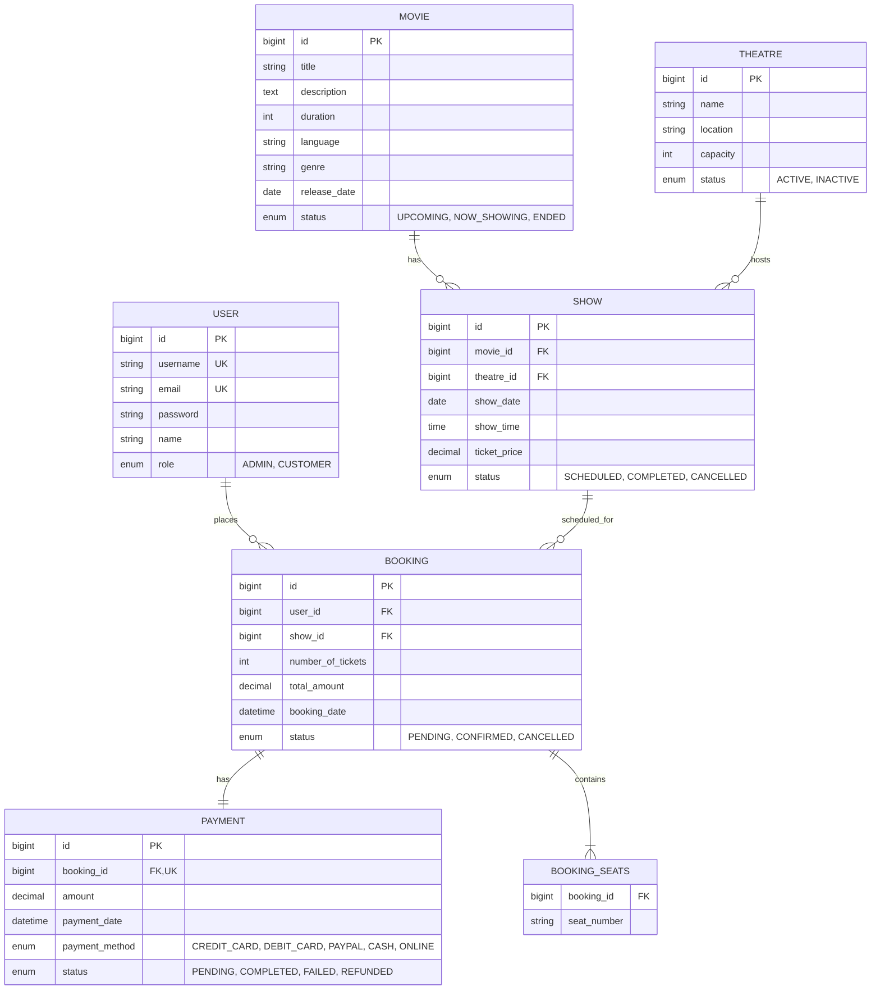

# Online Movie Ticket Booking System - Backend API

[](https://spring.io/projects/spring-boot)
[](https://www.oracle.com/java/)
[](https://spring.io/projects/spring-security)
[](https://www.mysql.com/)
[](https://www.ijse.lk/)

**IJSE | Institute of Software Engineering**  
**Coursework**: CMJD (Comprehensive Master Java Developer) – Batch 114/115  
**Assignment**: 1 – Backend Development with Spring Boot and MySQL  
**Task**: Movie Ticket Booking System  


---

## 📖 Project Overview

The **Online Movie Ticket Booking System** is a production-grade RESTful backend application built with **Spring Boot**, **Spring Security (JWT)**, **Spring Data JPA**, and **MySQL**. It enables customers to securely register, browse movies, check show schedules, select available seats, place ticket bookings, and make online payments. Administrators are empowered to manage users, movies, theatres, shows, bookings, and payment records.

---

## 🛠 Tech Stack

| Technology | Specification / Library |
| :--- | :--- |
| **Framework** | Spring Boot 3.3.4 |
| **Language** | Java 21 LTS |
| **Security** | Spring Security with Stateless JWT Authentication (`jjwt 0.12.6`) |
| **Persistence** | Spring Data JPA / Hibernate ORM |
| **Database** | MySQL 8.4 Server (`movie_booking_db`) |
| **Validation** | Spring Boot Starter Validation (`Hibernate Validator`) |
| **Utilities** | Lombok, SLF4J / Logback Logging |
| **Build Tool** | Apache Maven 3.9+ |

---

## 🏗 Project Architecture & Design Patterns

The project follows a standard **Layered Architecture**:
```
Controller (REST Endpoints & HTTP Handling)
    └── Service Interface & Implementation (Business Rules & Validation)
          └── Repository Interface (Spring Data JPA Data Access)
                └── MySQL Database (Entity Persistence)
```

- **DTO Pattern**: Request and Response DTOs strictly separate internal database models from API payload contracts.
- **Global Exception Handling**: Centralized `@RestControllerAdvice` formats error payloads consistently with accurate HTTP status codes (400 Bad Request, 401 Unauthorized, 403 Forbidden, 404 Not Found, 409 Conflict).
- **Security Filter Chain**: Intercepts requests via `JwtAuthenticationFilter` to validate Bearer tokens before reaching controller handlers.

---

## 📊 Database Configuration

### Configuration Settings (`application.properties`)
```properties
spring.application.name=movie-ticket-booking-system
server.port=8080

# Database Connectivity
spring.datasource.url=jdbc:mysql://localhost:3306/movie_booking_db?createDatabaseIfNotExist=true&useSSL=false&allowPublicKeyRetrieval=true&serverTimezone=UTC
spring.datasource.username=root
# Change this to your local MySQL root password
spring.datasource.password=abcd  
spring.datasource.driver-class-name=com.mysql.cj.jdbc.Driver

# JPA / Hibernate
spring.jpa.hibernate.ddl-auto=update
spring.jpa.show-sql=true

# Security JWT
app.jwt.secret=404E635266556A586E3272357538782F413F4428472B4B6250645367566B5970
app.jwt.expiration-ms=86400000
```

---

## 🗂 Entity Relationship Diagram (ERD)



---

## 🔐 Authentication & Authorization Instructions

Authentication uses JSON Web Tokens (JWT) in a stateless security context.

1. **Sign Up**: Register a customer or admin via `POST /api/auth/signup`.
2. **Sign In**: Authenticate via `POST /api/auth/signin` to receive a Bearer JWT token.
3. **Include Header**: For protected endpoints, attach the JWT token in the `Authorization` header:
   ```http
   Authorization: Bearer <YOUR_JWT_TOKEN>
   ```

### Default Pre-Seeded Accounts

When the application boots for the first time, default accounts and sample data are automatically initialized:

| Role | Username | Password | Email |
| :--- | :--- | :--- | :--- |
| **ADMIN** | `admin` | `admin123` | `admin@moviebooking.com` |
| **CUSTOMER** | `imeth_j` | `customer123` | `imeth@example.com` |
| **CUSTOMER** | `sonal_i` | `customer123` | `sonal@example.com` |

---

## 🚀 API Endpoints Overview

### 🔑 Authentication (`/api/auth`)
| Method | Endpoint | Access | Description |
| :--- | :--- | :--- | :--- |
| `POST` | `/api/auth/signup` | Public | Register new user |
| `POST` | `/api/auth/signin` | Public | Authenticate user & return JWT |

### 👤 User Management (`/api/users`)
| Method | Endpoint | Access | Description |
| :--- | :--- | :--- | :--- |
| `GET` | `/api/users` | `ADMIN` | Get all users |
| `GET` | `/api/users/{id}` | Authenticated | Get user details by ID |
| `PUT` | `/api/users/{id}` | Self / `ADMIN` | Update user details |
| `DELETE` | `/api/users/{id}` | `ADMIN` | Delete user |

### 🎬 Movie Management (`/api/movies`)
| Method | Endpoint | Access | Description |
| :--- | :--- | :--- | :--- |
| `POST` | `/api/movies` | `ADMIN` | Create new movie |
| `GET` | `/api/movies` | Public | Get all movies (supports title/language/status filters) |
| `GET` | `/api/movies/{id}` | Public | Get movie details by ID |
| `PUT` | `/api/movies/{id}` | `ADMIN` | Update movie details |
| `DELETE` | `/api/movies/{id}` | `ADMIN` | Delete movie |

### 🏛 Theatre Management (`/api/theatres`)
| Method | Endpoint | Access | Description |
| :--- | :--- | :--- | :--- |
| `POST` | `/api/theatres` | `ADMIN` | Create new theatre |
| `GET` | `/api/theatres` | Public | Get all theatres |
| `GET` | `/api/theatres/{id}` | Public | Get theatre by ID |
| `PUT` | `/api/theatres/{id}` | `ADMIN` | Update theatre |
| `DELETE` | `/api/theatres/{id}` | `ADMIN` | Delete theatre |

### 🎟 Show Management (`/api/shows`)
| Method | Endpoint | Access | Description |
| :--- | :--- | :--- | :--- |
| `POST` | `/api/shows` | `ADMIN` | Schedule new show |
| `GET` | `/api/shows` | Public | Get all scheduled shows |
| `GET` | `/api/shows/{id}` | Public | Get show details by ID |
| `PUT` | `/api/shows/{id}` | `ADMIN` | Update show |
| `DELETE` | `/api/shows/{id}` | `ADMIN` | Delete show |
| `GET` | `/api/shows/movie/{movieId}` | Public | Get shows for a specific movie |
| `GET` | `/api/shows/{id}/available-seats` | Public | View booked & available seats for a show |

### 🛒 Booking Management (`/api/bookings`)
| Method | Endpoint | Access | Description |
| :--- | :--- | :--- | :--- |
| `POST` | `/api/bookings` | `CUSTOMER` | Book movie tickets |
| `GET` | `/api/bookings/{id}` | Owner / `ADMIN` | Get booking details by ID |
| `GET` | `/api/bookings/my-bookings` | `CUSTOMER` | View authenticated customer's bookings |
| `GET` | `/api/bookings` | `ADMIN` | View all customer bookings |
| `PUT` | `/api/bookings/{id}/cancel` | Owner / `ADMIN` | Cancel a booking |

### 💳 Payment Management (`/api/payments`)
| Method | Endpoint | Access | Description |
| :--- | :--- | :--- | :--- |
| `POST` | `/api/payments` | `CUSTOMER` | Create & process payment |
| `POST` | `/api/payments/process` | `CUSTOMER` | Process payment for booking |
| `GET` | `/api/payments/{id}` | Owner / `ADMIN` | Get payment details by payment ID |
| `GET` | `/api/payments/booking/{bookingId}` | Owner / `ADMIN` | Get payment details by booking ID |
| `GET` | `/api/payments/{id}/status` | Authenticated | Check payment status |

---

## 📝 Sample REST API Requests & Responses

### 1. User Sign In (`POST /api/auth/signin`)
**Request:**
```json
{
  "username": "imeth_j",
  "password": "customer123"
}
```
**Response (200 OK):**
```json
{
  "token": "eyJhbGciOiJIUzM4NCJ9...",
  "type": "Bearer",
  "id": 2,
  "username": "imeth_j",
  "email": "imeth@example.com",
  "name": "Imeth Jayasinghe",
  "role": "CUSTOMER"
}
```

### 2. Create Booking (`POST /api/bookings`)
**Request:**
```json
{
  "showId": 1,
  "seatNumbers": ["A1", "A2", "A3"],
  "numberOfTickets": 3
}
```
**Response (201 Created):**
```json
{
  "id": 1,
  "user": {
    "id": 2,
    "username": "imeth_j",
    "email": "imeth@example.com",
    "name": "Imeth Jayasinghe",
    "role": "CUSTOMER"
  },
  "show": {
    "id": 1,
    "movie": {
      "id": 1,
      "title": "Avatar: The Way of Water",
      "duration": 192,
      "language": "English",
      "genre": "Sci-Fi",
      "status": "NOW_SHOWING"
    },
    "theatre": {
      "id": 1,
      "name": "Scope Cinemas - CCC",
      "capacity": 150,
      "status": "ACTIVE"
    },
    "showDate": "2026-09-28",
    "showTime": "14:30:00",
    "ticketPrice": 1500.00,
    "status": "SCHEDULED"
  },
  "seatNumbers": ["A1", "A2", "A3"],
  "numberOfTickets": 3,
  "totalAmount": 4500.00,
  "bookingDate": "2026-09-27T06:49:17",
  "status": "PENDING",
  "paymentId": null,
  "paymentStatus": null
}
```

### 3. Double Booking Seat Conflict Error (`POST /api/bookings`)
**Response (409 Conflict):**
```json
{
  "timestamp": "2026-09-27T06:49:37.849726",
  "status": 409,
  "error": "Conflict",
  "message": "Seat A1 is already booked for this show",
  "path": "/api/bookings",
  "validationErrors": null
}
```

### 4. Process Payment (`POST /api/payments/process`)
**Request:**
```json
{
  "bookingId": 1,
  "paymentMethod": "CREDIT_CARD"
}
```
**Response (200 OK):**
```json
{
  "id": 1,
  "bookingId": 1,
  "amount": 4500.00,
  "paymentDate": "2026-09-27T06:49:18",
  "paymentMethod": "CREDIT_CARD",
  "status": "COMPLETED",
  "movieTitle": "Avatar: The Way of Water",
  "theatreName": "Scope Cinemas - CCC",
  "seatNumbers": ["A1", "A2", "A3"]
}
```

---

## ⚡ How to Run the Project

### Prerequisites
- Java JDK 21 or Java 25 installed
- Apache Maven 3.9+ installed
- MySQL 8.0 / 8.4 Server running on port 3306

### Steps to Run

1. **Clone the Repository**:
   ```bash
   git clone <YOUR_GITHUB_REPOSITORY_URL>
   cd backend
   ```

2. **Configure Database Credentials**:
   Ensure MySQL is running locally on port 3306 and update `src/main/resources/application.properties` if your MySQL username/password differs from default `root` / `abcd`.

3. **Build the Application**:
   ```bash
   mvn clean compile
   ```

4. **Run the Spring Boot Backend**:
   ```bash
   mvn spring-boot:run
   ```
   The backend server will start on `http://localhost:8080`.

---

## 🔮 Future Expansion – Student Proposal

### Proposal 1: Screen / Auditorium & Dynamic Seat Layout Entity Enhancement

#### 1. Proposed Feature:
Currently, the `Theatre` entity directly contains `capacity`, and shows are assigned to theatres. In modern multiplex cinema systems (e.g. Scope Cinemas, PVR), a theatre complex contains multiple screens/auditoriums (Screen 1 - Dolby Atmos, Screen 2 - IMAX 3D), each with specific seat category pricing (VIP, Executive, Normal) and physical row/column layouts.

#### 2. Why the Feature is Useful:
- Allows cinema owners to manage multiple screens per theatre complex.
- Supports tiered seat pricing (e.g., Row A-D Executive LKR 1,500; Row E-H VIP LKR 2,500).
- Enables real-time graphical seat map rendering for frontend applications.

#### 3. Affected Existing Entities:
- **`Theatre`**: Remove single `capacity` attribute; add `OneToMany` relationship to `Screen`.
- **`Show`**: Re-map `Show` M:1 to `Screen` instead of directly to `Theatre`.
- **`Booking`**: Calculate total amount dynamically based on individual selected seat tier prices.

#### 4. New Required Entities:
- **`Screen`**: (`id`, `screenName`, `screenType`, `capacity`, `theatre_id`)
- **`Seat`**: (`id`, `screen_id`, `rowName`, `seatNumber`, `seatCategory` [VIP/REGULAR])

#### 5. Database Relationship Extensions:
```
Theatre 1:M Screen
Screen 1:M Seat
Screen 1:M Show
Show 1:M SeatPricing
```

---

### Proposal 2: Promotional Discounts, Coupon Codes & Customer Loyalty System

#### 1. Proposed Feature:
Introduce a promo code, discount coupon, and loyalty reward points system where customers earn points per booking and redeem discount codes during checkout.

#### 2. Why the Feature is Useful:
- Increases customer retention and booking frequency.
- Enables marketing teams to run seasonal campaigns (e.g., "50% OFF on Wednesdays" with code `WED50`).

#### 3. Affected Existing Entities:
- **`Booking`**: Add `discountAmount`, `finalPaidAmount`, and optional `coupon_id` relationship.
- **`User`**: Add `loyaltyPoints` field.

#### 4. New Required Entities:
- **`Coupon`**: (`id`, `code`, `discountPercentage`, `maxDiscount`, `validFrom`, `validUntil`, `status`)

#### 5. Database Relationship Extensions:
```
Coupon 1:M Booking (Optional 0..1 relationship)
User 1:M LoyaltyTransaction
```

---

## 📤 GitHub Repository Submission Guide

1. Ensure `.gitignore` excludes `target/`, IDE folders (`.idea`, `.vscode`), and temporary credentials.
2. Initialize git and commit:
   ```bash
   git init
   git add .
   git commit -m "Initial commit: Complete Spring Boot Movie Ticket Booking System Backend"
   git branch -M main
   git remote add origin <YOUR_GITHUB_REPO_URL>
   git push -u origin main
   ```
3. Submit the GitHub repository link via the IJSE Student Portal.

---

## 👨‍💻 Developer & Coursework Details
- **Course**: CMJD (Comprehensive Master Java Developer) Batch 114/115
- **Institute**: Institute of Software Engineering (IJSE), Sri Lanka
- **Module**: Assignment 1 - Spring Boot & MySQL Backend Architecture
